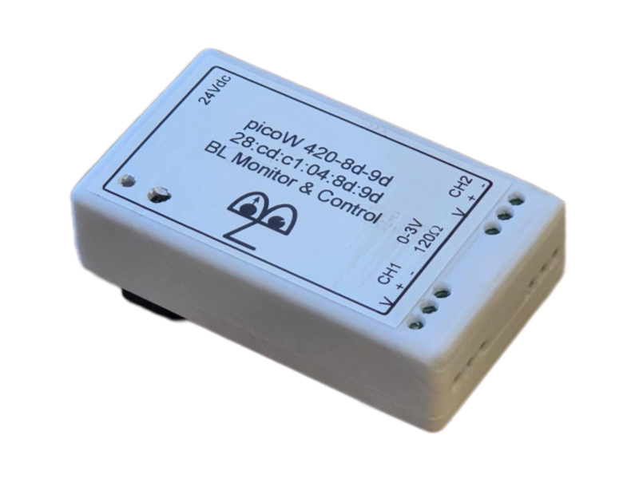

# 4–20 mA Cube

**Two-channel, wireless current-loop acquisition for connecting industrial 4–20 mA sensors to the Blinky-Lite control system in their natural engineering units.**

| Enclosure | PCB |
|-----------|-----|
||

## Overview

The 4–20 mA Cube is a compact, wireless instrumentation module in the Blinky-Lite Instrumentation Platform. It is designed to read two 4–20 mA current-loop signals near the equipment or sensors being monitored, then communicate scaled measurements and alarms to a central Blinky-Lite control system.

Current-loop sensors are widely used in industrial environments for measurements such as flow, pressure, level, and process temperature. Each channel includes a 24 V field-device supply connection and a dedicated current-sensor input, making it straightforward to connect compatible two-wire transmitters.

Built around the Raspberry Pi Pico W / RP2040, the module uses 2.4 GHz Wi-Fi and MQTT publish/subscribe communication. This event-driven approach supports distributed deployments without wired data connections and enables Blinky-Lite to use device information for recording, notifications, visualisation, and machine-protection workflows.

### Key features

- Two-channel current-loop acquisition: Read two independent 4–20 mA industrial sensor signals.
- Integrated field-device power: Each channel provides a 24 V pin for powering a connected external device.
- 1 kHz analog bandwidth: Capture changing process signals with a 1 kHz analog bandwidth per channel.
- Remotely configurable digital filtering: Reduce the effective bandwidth for improved noise performance when a slower measurement response is appropriate.
- High-resolution readout: 0.04% readout resolution.
- Engineering-unit scaling: Configure output scaling in Blinky-Lite so current-loop sensors can be viewed and used in their natural units.
- PLC-style field wiring: 5 mm screw terminals simplify connection of sensors and field wiring in PLC-like installations.
- Event-driven integration: MQTT publish/subscribe communication with Blinky-Lite.
- Open-source firmware: Microcontroller code can be adapted for site-specific instrumentation and integration requirements.

### Technical summary

| Specification | Details |
|---------------|---------|
| Primary function | 4–20 mA current-loop acquisition and scaling |
| Sensor / interface | Industrial 4–20 mA current-loop transmitters, including flow and pressure sensors |
| Channels | Two independent current-loop channels |
| Measurement / operating range | 4–20 mA per channel |
| Readout resolution | 0.04% |
| Input impedance | 120 Ω per channel |
| Analog bandwidth | 1 kHz per channel |
| Digital filtering | Remotely controllable digital filter for lower effective bandwidth and improved noise performance |
| Inputs / outputs | Per channel: one 24 V field-device supply pin and two current-sensor input pins; 5 mm screw terminals for field wiring |
| Power input | 24 V DC via 2.1 mm barrel connector |
| Wireless | 2.4 GHz Wi-Fi |
| Communication | MQTT publish/subscribe protocol |
| Controller | Raspberry Pi Pico W / RP2040 |
| PCB dimensions | 50 mm × 87 mm |
| Enclosure and mounting | 55 mm × 93 mm × 26 mm; DIN Mod3-compatible enclosure with removable DIN-rail mount |
| Platform | Blinky-Lite Instrumentation Platform |

### Typical applications

- Flow-meter monitoring
- Pressure-sensor monitoring
- Industrial process instrumentation
- Distributed sensor installations requiring central visibility and configurable filtering
- Alarm and machine-protection workflows based on process values

## Getting started

### Hardware

1. Install the 4–20 mA Cube close to the current-loop sensors or process signals to be monitored.
2. Connect each transmitter to its assigned 5 mm screw terminals, including the channel’s 24 V field-device supply pin where required.
3. Connect the current-loop signal to the two input terminals for its channel according to the product wiring documentation.
4. Power the cube from a regulated 24 V DC supply through the 2.1 mm barrel connector.
5. Verify that each connected sensor and its wiring are compatible with the channel’s 4–20 mA input and 24 V supply arrangement.
6. Mount the enclosure on a DIN rail when required, or remove the DIN-rail mount for an alternative installation.

### Firmware build target

The firmware targets the Raspberry Pi Pico W / RP2040 using the Arduino-Pico board support.
- Board: Pico W / RP2040-compatible target
- Flash layout: Sketch 1920 KB, filesystem 128 KB
- FQBN flash option: flash=2097152_131072

### Open-source software and licensing

The firmware is released under the MIT License, giving users broad permission to study, modify, and adapt the code for their own applications. The open hardware design can likewise be customised to suit site-specific requirements. The firmware uses the open-source Arduino-BlinkyPicoW library, which is also available under the MIT License.

### Configuration

1. Build and upload the firmware using the project’s source and configuration files.
2. Use the onboard web interface to set or update Wi-Fi credentials.
3. Configure the MQTT connection and create the corresponding device integration in Blinky-Lite.
4. Set channel scaling so each 4–20 mA input is reported in the sensor’s required engineering units.
5. Set the digital filter bandwidth, alarm thresholds, and any required operating limits for each channel.
6. Verify that normal measurements and alarm events appear as expected in Blinky-Lite.

### Integration model

The 4–20 mA Cube uses MQTT to publish scaled measurements and alarm events. This event-driven model avoids conventional polling and enables prompt control-system responses to changing process conditions.

In a typical deployment, the device connects by Wi-Fi to the network and communicates through an MQTT broker. Blinky-Lite represents it as an integrated instrumentation node and can use its information for recording, display, notification, alarms, and machine-protection logic.

### Measurement, safety, and installation considerations

- Confirm that connected transmitters, current loops, wiring, and environmental conditions are within the product’s specified limits.
- Verify correct polarity and wiring before energising the 24 V field-device supply.
- Apply channel scaling and digital filter settings appropriate to the sensor and required measurement response.
- Validate normal operation and alarm behaviour against a known reference source before relying on the device for operational or protection decisions.
- Review connector, cable, grounding, shielding, enclosure, and environmental requirements before installation.

